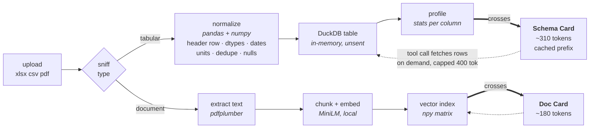
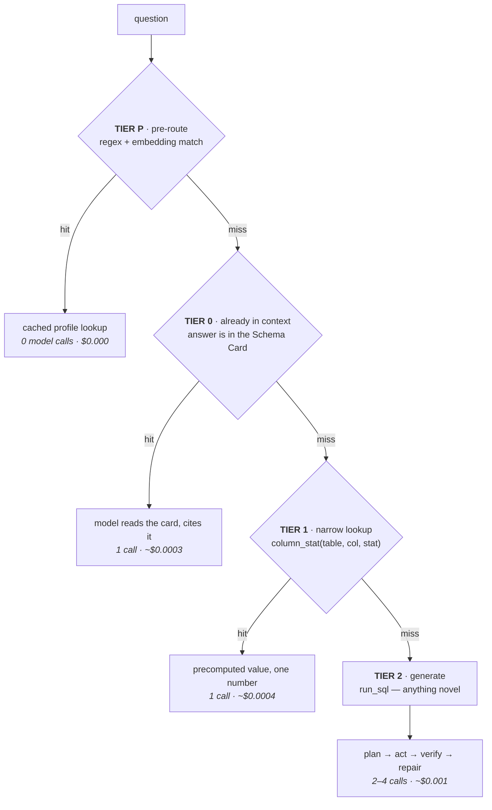
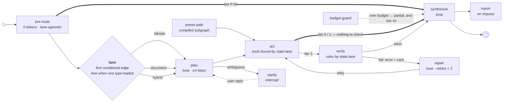
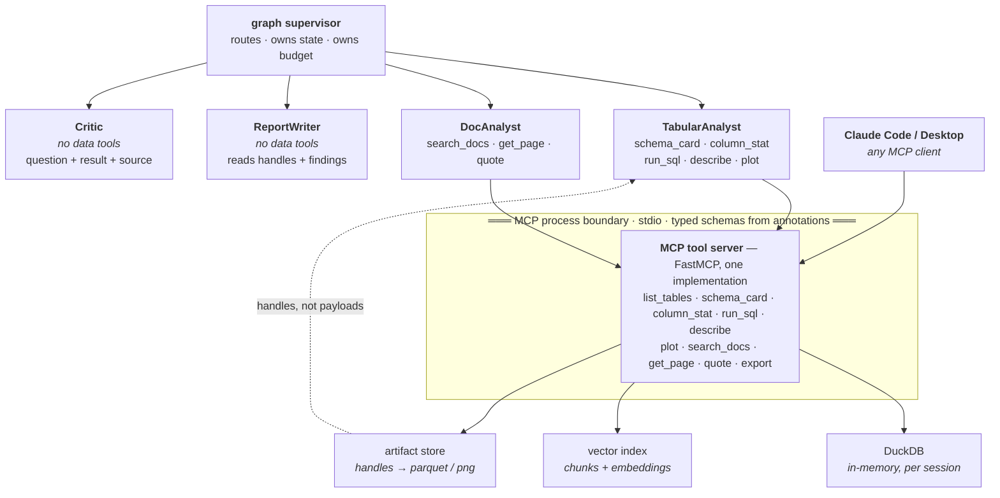

# DataSurf — Build Plan

> Upload a spreadsheet, get an analyst. The engineering worth showing is everything the model never sees.

**Draft 2 · 2026-09-29**
Interactive version: <https://claude.ai/artifact/TC31Sz8Thn1NEhKesBuWh9>

> **This document is the *why*.** For what to build in what order see
> [modules.md](modules.md) (M1–M4, milestones, build order); for where the code goes see
> [folder-structure.md](folder-structure.md). Where the module map and this document disagree on
> *what to build next*, the module map wins.

A Streamlit-fronted data-analyst agent: ingest xlsx / csv / pdf, normalize with pandas, answer
questions over DuckDB and a vector index, and run one-click analysis presets. Built to demonstrate
agent harness design, tool calling over MCP, LangGraph state machines, multi-agent routing, and
measured token optimization.

| | |
|---|---|
| Phases | 6 |
| Orchestration | LangGraph |
| Tools | FastMCP 4.x |
| Query engine | DuckDB (in-memory) |
| Model | `openai/gpt-6-luna` via OpenRouter |
| Projected spend through P5 | under $5 |

---

## 1. Decisions already made

| Decision | Settled on | The reason that actually decided it |
|---|---|---|
| model | `openai/gpt-6-luna` via OpenRouter | $0.10/M in, $0.50/M out, 1.05M context, native tool calling, structured outputs, 10× prompt-cache discount. Not Anthropic direct — one OpenAI-compatible endpoint keeps the model a config value. |
| query engine | DuckDB, in-memory | SQL is a safe action space for a model; pandas is not. Reads registered DataFrames without a copy, and columnar aggregation is the exact workload. |
| persistence | none — fully ephemeral | Not a platform. Plug a file in, talk to it, close the tab. No Postgres, no accounts, no migrations, nothing to clean up. |
| tool boundary | FastMCP 4.x, real server process | "My tools run in Claude Code too" is a stronger claim than "I used the MCP types", and the cost is one subprocess. |
| answer routing | four tiers, cheapest first | Prefer a precomputed number over a generated query. A number your own code produced cannot be hallucinated. |
| graph shape | one graph; lane is the first conditional edge | `tabular` · `document` · `hybrid` carried in `state.lane`, parameterizing shared nodes instead of duplicating them. Usually costs zero tokens — the file type is known at upload. |
| memory | session-scoped only, **initial phase** | Data dictionary, semantic cache and rolling summary die with the tab. Domain facts are authored code in `domains/`. Deferred, not rejected — see the two upgrade seams below. |
| domain knowledge | packs, not agents | Four specialists would write identical SQL. What differs is vocabulary, metrics, presets and caveats — so ship those, loaded one at a time. |
| demo data | committed synthetic fixtures ✓ | Reproducible evals, and no privacy question to answer about a free-tier endpoint that may log prompts. |

### ✅ Blocker cleared — 2026-09-29

The venv was on Python 3.9.6, which ruled out FastMCP entirely. Rebuilt on **Python 3.12.13** and
reinstalled against the trimmed `requirements.txt`. Verify any time with:

```
.venv/bin/python check_env.py
```

That script does more than resolve imports — it asserts the two things the architecture rests on:
DuckDB querying a registered pandas DataFrame in place, and FastMCP deriving a tool schema from type
annotations. Installed and passing:

| | | | |
|---|---|---|---|
| python 3.12.13 | pandas 3.0.6 | numpy 2.5.3 | scipy 1.18.1 |
| duckdb 1.5.6 | pyarrow 25.0.1 | openpyxl 3.1.5 | pdfplumber 0.11.10 |
| langgraph 1.2.12 | langchain-core 1.6.6 | langchain-openai 1.6.6 | openai 3.20.0 |
| pydantic 2.13.5 | fastmcp 4.0.10 | mcp 2.2.0 | tabulate 0.10.0 |
| streamlit 1.64.0 | plotly 7.1.0 | pytest 9.1.1 | |

`sentence-transformers` is deliberately deferred to P3 — it pulls torch (~2GB) and the PDF lane does
not exist yet.

### ⚠ Open conflict: fixtures are gitignored

`.gitignore:17` excludes `data/`, and the file globs below it exclude `*.csv`, `*.xlsx` and `*.pdf`
outright. But **committed synthetic fixtures** is a settled decision — it is what makes the evals
reproducible and sidesteps the privacy question. Two lines fix it:

```gitignore
!data/fixtures/
!data/fixtures/**
```

Not applied yet.

---

## 2. Model selection

Every candidate was checked against the live OpenRouter catalog rather than assumed.

| Role | Model | in / out per M | Cache read | Context |
|---|---|---|---|---|
| **primary** | `openai/gpt-6-luna` | $0.10 / $0.50 | $0.01 | 1,050,000 |
| free fallback | `nvidia/nemotron-3-super-120b-a12b:free` | free | — | 262,144 |
| eval comparison | `deepseek/deepseek-v4-flash` | $0.05 / $0.11 | $0.011 | 1,048,576 |
| upgrade path | `openai/gpt-6-sol` | $2.00 / $10.00 | $0.20 | 1,050,000 |

### Rejected, and why

- **`openai/gpt-5.6-luna`** — superseded. `gpt-6-luna` is newer at *half* the input price and 2.4×
  cheaper output, with identical context and cache economics. No argument for 5.6.
- **`nvidia/nemotron-3-ultra-550b-a55b:free`** — tool calling yes, **structured outputs no**. Our
  `plan` node emits pydantic-validated JSON, so this would force a JSON-in-prompt fallback plus a
  parse-repair loop. Meanwhile `nemotron-3-super` (smaller, also free) has both and is explicitly
  described for complex multi-agent applications.

### ⚠ The trap in the free tier

OpenRouter's `:free` endpoints allow **20 requests/minute and 50 requests/day** with no credits
ever purchased — rising to **1000/day** once $10 lifetime has been spent. This graph makes 3–6 model
calls per question. At 50/day that is **eight to sixteen questions per day, total**, and a single
30-question eval run needs 90–180 calls — two to four days per run. You cannot build an agent on that.

### Which makes the spend decision easy

Per tier-2 question (~3 calls, ~4.5k in / 1.2k out) luna costs **about $0.001**.

| | Cost |
|---|---|
| One question | ~$0.001 |
| One 30-question golden-set run | ~$0.03 |
| Fifty eval runs during P5 | ~$1.50 |
| Whole project through P5 | under $5 |

A single $10 top-up buys the paid model *and* lifts the free tier to 1000/day. **Stop optimizing for
free** — the rate limits cost more in lost evenings than the model ever costs in dollars.

### Two knock-on effects

**Prompt caching survives.** Luna reads cache at $0.01/M against $0.10/M input — a 10× discount.
Dropping Anthropic looked like it would cost us this technique; it doesn't.

**The model cascade is replaced by something better.** With one model there are no tiers to cascade
between, so routing moves from "use a cheaper model for the easy node" to **"don't call a model at
all"** — the deterministic pre-router in §5. Removing the call beats discounting it.

**And the eval harness becomes the story.** Run the golden set across luna, nemotron-super and
deepseek-flash and publish the comparison: accuracy, tokens, cost, tool-selection correctness per
tier. That costs roughly ten cents and is a far stronger artifact than "I picked a model" — it also
turns `agent/llm.py` from boilerplate into the thing that makes the comparison possible.

---

## 3. Stack

| Layer | Choice | Instead of — and why |
|---|---|---|
| ui | Streamlit + Plotly | Not FastAPI + React. The frontend is not the skill on display. |
| orchestration | LangGraph | Not a LangChain `AgentExecutor`. A graph has inspectable state, conditional edges, checkpoints, and a retry loop you can draw. A while-loop has none of that. |
| model access | One `agent/llm.py` adapter — OpenAI-compatible client pointed at OpenRouter | Not `langchain-anthropic`, and not provider calls scattered through the nodes. The model becomes one env var, which is what makes the multi-model eval possible. |
| tabular engine | DuckDB over registered dataframes | Not `exec()`'d pandas. SQL is sandboxed, printable, diffable, cheap to verify. |
| normalize | pandas + numpy | snake_case headers, header-row detection, dtype coercion, date parsing, unit stripping, dedupe, missingness map. Deterministic, zero tokens. |
| statistics | pandas + numpy + scipy | Not SQL. Every deterministic preset is your code, so use the tools built for statistics. |
| rag | pdfplumber → chunks → MiniLM embeddings → numpy cosine over one matrix | Not Chroma or pgvector yet. A pickled float32 matrix beats a vector database until ~20k chunks. |
| tools | MCP server on **FastMCP** (`fastmcp`, 4.0.10 installed), agent as client | Not tools defined inline. The standalone package is where auth, server composition and the client library live — and as of `mcp` 2.x the old bundled `mcp.server.fastmcp` copy is gone entirely, so this is the only FastMCP. |
| contracts | pydantic v2 | Every tool signature and every structured output. A plan that fails validation is a repair, not a crash. |
| observability | JSONL trace per run + SQLite index + `replay.py` | Not LangSmith as the only record. Local traces replay offline into deterministic regression tests built from real sessions. |
| evals | pytest over ~30 golden questions on 3 fixtures, against 3 models | Not vibes. Numerics checked exactly, citations checked for existence, narrative judged by a model. |

---

## 4. pandas and DuckDB are not competing

> **The rule: model-written logic → always DuckDB SQL. Your-written logic → pandas / numpy / scipy.**

The reason DuckDB is in this project is not performance. It is that a model emitting pandas means
`exec()`-ing arbitrary Python — it can `import os`, it can mutate the DataFrame and silently poison
every later answer, and you cannot check it before it runs. `df.query()` is no escape; it filters
rows and nothing else. A model emitting SQL produces a *string*: parseable before execution,
restrictable to `SELECT`, read-only by connection config, reproducible forever, and readable by a
user who can tell you it's wrong.

| Layer | When it runs | Engine | Work |
|---|---|---|---|
| 1. ingestion | once, on upload | pandas + numpy | Read xlsx, detect header row, snake_case columns, coerce dtypes, parse dates, strip `$` and separators, drop stray total rows, dedupe, build the Schema Card. The model never sees this code. |
| 2. tools | per model tool call | mostly DuckDB | `run_sql` → DuckDB, the only tool running model-authored logic. `describe` → DuckDB `SUMMARIZE`. `search_docs` → numpy cosine. `plot` → pandas, but only over an already-aggregated result. `schema_card` → cached text, no compute. |
| 3. presets | on button click | pandas + numpy + scipy | Outliers, correlations, seasonal decomposition, effect sizes, null clustering. Your statistics code — which is why presets are deterministic and why `scipy` earns its place. |

The handoff, in full:

```python
df = normalize(pd.read_excel(path, sheet_name="Q1-Q4", header=3))   # pandas owns this
con.register("sales_2024", df)                                      # now queryable as SQL
# no export, no COPY, no second materialized copy for numeric columns.
# pandas still owns the DataFrame — Plotly and the cleaned-export preset need it.
```

---

## 4a. Memory: ephemeral now, two seams kept clean

Nothing persists in the initial phase. But "we might persist later" is only cheap if the state has a
boundary now, so two seams get designed today and cost nothing until used.

**Seam 1 — graph state is already portable.** LangGraph's checkpointer is the abstraction. Build with
`MemorySaver`; persistence later is swapping it for `SqliteSaver`. That is a one-line change *provided*
every field the agent needs to resume lives in `State` rather than in a Streamlit widget or a module
global. Free today, and it is the whole reason the graph carries `lane`, `handles` and `budget`
explicitly instead of reaching for them.

**Seam 2 — one session object owns everything else.** DuckDB connection, registered table names,
Schema Cards, the data dictionary, the semantic cache, preset findings. All on a single `Session` in
`ingest/store.py`; nothing else holds session state. Persisting later means serializing one object.
The discipline is not writing the serializer — it is refusing to stash state anywhere else.

| | Today | If persistence lands later |
|---|---|---|
| graph state | `MemorySaver` | `SqliteSaver`, one line |
| session state | one `Session` object, in memory | serialize that object |
| domain facts | authored code in `domains/` | unchanged — already ships with the repo |
| user data | never written to disk | a decision to revisit explicitly, with a privacy note |

**What does not get built now:** no storage layer, no schema, no migrations, no cleanup job, no
"pluggable backend" interface with one implementation. The seams are a shape, not an abstraction.

---

## 5. Ingestion and the context boundary

The single most important line in the system: raw rows and raw pages stay on the left of it. Only
compact cards cross into the prompt.



Everything left of the crossing dies with the session. Rows only ever travel back across as a capped
tool result the agent explicitly asked for, never as bulk context.

### The Schema Card is the whole trick

Written once per table at ingest, cached, and it becomes the stable prefix of every prompt about that
table — which is exactly what luna's 10× cache discount applies to. The model plans against the card,
not against the data.

```
table sales_2024   18,442 rows × 12 cols · sheet "Q1-Q4" · header detected row 4

order_date    date      2023-01-03 → 2024-12-30        null  0.0%
region        cat(4)    North | South | East | West    null  0.2%
rep_id        int       1001 → 1247  (247 distinct)    null  0.0%
product       cat(38)   "Atlas Pro", "Beacon", +36     null  0.0%
units         int       1 → 480      μ=23  σ=41        null  1.1%
revenue       float     12.40 → 98,430.00  μ=1,204.37  null  1.1%   [was "Revenue ($)"]
discount_pct  float     0.0 → 0.45   μ=0.0713         null 14.3%   ⚠ high missingness
… 5 more columns

notes  dedupe removed 212 exact-duplicate rows
       discount_pct nulls cluster in region=East (91% of them)
       candidate keys: rep_id → reps.csv (98.4% overlap)

cost   ≈ 310 tokens   · the same sheet as raw CSV ≈ 640,000 tokens (est.)
```

Three details are doing real work:

- **The rename trail** (`revenue [was "Revenue ($)"]`) lets the model answer in the user's vocabulary
  while querying the canonical column.
- **The notes block** carries findings the profiler computed deterministically, so the model gets
  clustered missingness and join candidates for free instead of burning a tool call.
- **The precision is deliberate** — `μ=1,204.37` not `μ=1,204`, because a rounded figure in the card
  becomes a wrong figure in the answer.

---

## 6. Four-tier answer resolution

The agent should not write a query for something already computed. Each question is resolved at the
cheapest tier that can answer it, and **only the last tier can be wrong.**



| Tier | The test | Model calls | Can it be wrong? |
|---|---|---|---|
| **P** | regex + embedding match → cached profile | **0** | No — no model involved |
| **0** | answer already in the Schema Card in context | 1 | Misreading only — card carries full precision |
| **1** | `column_stat` lookup over precomputed values | 1 | No — your code computed it |
| **2** | `run_sql`: group-by, filter, join, window | 2–4 | **Yes** — which is why `verify` exists |

**Do not expose a `get_eda_results()`** that dumps an analysis blob into context — that re-creates the
exact problem the Schema Card solves. Tier 1's narrow typed signature *is* the optimization: ~20
tokens in, ~30 out, one value, with provenance.

Two consequences:

- **`verify` becomes a conditional edge.** Tiers P/0/1 bypass it entirely — nothing to check when
  your own code produced the number.
- **Tool-selection quality stops being critical.** The deterministic pre-router means the design does
  not depend on the model's judgment for common cases. A bad tool choice then costs one cheap call
  rather than a wrong answer.

### Precompute budget

Profiling computes cheap per-column stats at ingest — that *is* the Schema Card, and it's fast.
Correlations, outlier scans and seasonal decomposition stay **preset-triggered, never
ingest-triggered**, or every upload pays for analyses nobody asked for. But once a preset has run,
cache its findings so `column_stat` can serve from them: tier 1 gets richer as the session goes on.

**README metric:** what share of the golden set resolved at each tier.

---

## 7. The graph — one graph, lane-first

The graph is the harness. Every node is either one model call with one job or deterministic Python,
and the only cycle in the whole system is the repair loop.



### The lane edge deleted a node

Earlier drafts had a `route` node — a luna call classifying each question as tabular, document, hybrid,
preset or ambiguous. Making the lane the first conditional edge **removes that node entirely**, because
every branch it used to own now has a cheaper owner:

| `route` used to decide | Now decided by | Cost |
|---|---|---|
| tabular vs document vs hybrid | the lane edge, from session inventory | **0 tokens** when one type is loaded |
| preset | a button press in the UI | 0 tokens |
| ambiguous | `plan`, which is already reading the question | folded into a call that was happening anyway |

`ingest/router.py` already knows what the session holds, so asking a model to re-derive it was paying
for a fact we had. That is one model call saved on **every single question** — the same saving the tier
router makes, found in a different place.

| `state.lane` | tools bound to `act` | rules applied by `verify` |
|---|---|---|
| `tabular` | `run_sql` · `column_stat` · `describe` · `plot` | row count re-runs; figures reconcile against a second aggregate |
| `document` | `search_docs` · `get_page` · `quote` | cited page exists; the quote actually appears on it |
| `hybrid` | both sets | both of the above, plus: do the two sources agree? |

| `state.lane` | tools bound to `act` | rules applied by `verify` |
|---|---|---|
| `tabular` | `run_sql` · `column_stat` · `describe` · `plot` | row count re-runs; figures reconcile against a second aggregate |
| `document` | `search_docs` · `get_page` · `quote` | cited page exists; the quote actually appears on it |
| `hybrid` | both sets | both of the above, plus: do the two sources agree? |

**State:** `messages` · `lane` · `schema_cards` · `doc_cards` · `handles{}` · `plan[]` · `tier` · `retries` ·
`budget{tok_in, tok_out, cached, usd}` · `trace_id`

`verify` is the node that makes this defensible: it re-runs the generated query's row count, checks
reported figures reconcile against a second aggregate, and confirms every cited PDF page exists. A
model that quietly invents a plausible number fails here rather than on screen. The repair edge feeds
the error text plus the Schema Card back to the planner, capped at two attempts, then answers honestly
with what it has.

---

## 8. Agents and the MCP boundary

Each specialist gets a short system prompt and only the tools it needs. That is not tidiness — every
extra tool schema is tokens on every turn, and every extra agent is another copy of the context.



ReportWriter and Critic deliberately have no path through the boundary: the writer composes from
handles the analysts already produced, and the critic judges the question, the result and its
provenance **without the ability to re-query** — which is what makes its verdict independent.

The `Claude Code` edge is the reason for the boundary at all: **the same server, unchanged, is a tool
provider for Claude Code.**

---

## 9. Token optimization

The section that makes this a portfolio piece rather than a demo. Every technique is a measured line
in the run ledger, not a claim.

### The funnel — projected context per question

| Stage | Tokens | |
|---|--:|---|
| raw dump baseline | 640,000 | `████████████████████` |
| + Schema Card | 4,200 | `███████` |
| + prune tool schemas | 2,600 | `██████` |
| + result handles | 1,900 | `█████▌` |
| + rolled-up history | 1,400 | `█████` |
| billed after cache read | ≈520 effective | `███` |

The first row is the honest naive implementation most tutorials ship: paste 200 rows into the prompt,
hand the model all ten tools, replay the full chat history. Each row below removes one cause. The last
row changes the *price* rather than the size (luna's cache reads at $0.01/M against $0.10/M input) —
it is a cost-equivalent figure, not a smaller prompt.

**These are estimates, not measurements.** P5 replaces every number with the token ledger's medians
over the golden set — including where a technique earns nothing.

### The techniques

| Technique | Mechanism | Where it lives |
|---|---|---|
| tier routing | Resolve each question at the cheapest tier that can answer it. Subsumes what a model cascade used to do. | `agent/graph.py` |
| schema cards | Rows never enter the prompt. The model plans against a profiled card and fetches data only through capped tool calls. | `ingest/profile.py` |
| handle pattern | Tool results go to the artifact store; context gets `handle + shape + head(3) + summary`, hard-capped at 400 tokens. Later steps pass handles, not payloads. | `agent/context.py` |
| prompt caching | Cache the stable prefix — system prompt, schema cards, data dictionary. Longest-lived prefix first. | `agent/context.py` |
| semantic cache | Question embedding → nearest prior question; on cosine > 0.95 with an unchanged table version, replay the stored SQL for zero model tokens. | `harness/cache.py` |
| rolling summary | After 8 turns, older messages compress to a ≤200-token digest. Schema and user-stated constraints pinned so they can never be summarized away. | `agent/context.py` |
| tool-schema pruning | Only the active specialist's tools are serialized into the request. Ten schemas cost real tokens every turn. | `tools/client.py` |
| structured output | Plans and critiques are pydantic JSON via native structured outputs. No preamble, no restated question. | `agent/state.py` |
| budget guard | Per-question ceilings on tokens, steps, wall-clock. Over budget degrades to a partial answer that says so, instead of looping. | `harness/budget.py` |
| the ledger | Every node logs tokens in / out / cached and cost from OpenRouter's usage field. Live in the sidebar; medians in the README. **This is what makes the rest provable.** | `harness/trace.py` |

---

## 10. Presets — ten one-click analyses

A preset is a **compiled subgraph with a fixed tool sequence**, not a canned prompt. Most of the work
is deterministic pandas and scipy; the model only writes the narrative around numbers it did not
invent. Fast, cheap, identical every time. Their findings also feed tier 1 for the rest of the session.

| Preset | What it does | Kind | Phase |
|---|---|---|---|
| Data health report | Nulls, duplicates, type mismatches, constant columns, IQR outliers, mixed date formats, leading-zero loss in IDs | deterministic | P2 |
| Auto-EDA brief | Distributions, top correlations with effect sizes, cardinality map, guess at keys / measures / dimensions | deterministic | P2 |
| Ask 5 smart questions | Proposes questions this data can actually answer, given the Schema Card. Each is a button. Best onboarding for a blank chat box. | model | P2 |
| Data dictionary | Column descriptions from names and samples, user-editable, folded back into the Schema Card so every later answer is sharper. The one preset that compounds — lives in session state, not on disk. | model | P2 |
| Executive summary | One page: what this dataset is, five findings with the query behind each, three caveats from the health report. Exports md / xlsx. | model | P3 |
| Anomaly hunt | Per-column outliers plus per-segment deviation from group mean, ranked. Answers "what looks wrong here" unprompted. | deterministic | P3 |
| Trend & seasonality | Only offered when the profiler finds a usable date column. Resample, decompose, naive baseline forecast with the error stated. Refuses rather than guesses on short series. | deterministic | P3 |
| Segment comparison | Pick a dimension, get a metric diff table with effect size *and sample size*, so a 300% lift on n=2 is visibly not a finding. | deterministic | P3 |
| Join finder | Across multiple uploads: propose join keys by name similarity, dtype and actual value overlap, and report overlap % before anyone joins on a bad key. | deterministic | P4 |
| Cleaned export | Download the normalized table with a changelog of every transformation. Makes the invisible pandas work auditable — which is what earns trust in the numbers. | deterministic | P4 |

---

## 11. Repo layout

Nothing in this tree gets created before the phase that needs it. P0 is `app.py` and three modules.

```
datasurf/
  app.py                # streamlit: upload · chat · preset buttons · token ledger sidebar
  agent/
    llm.py              # OpenRouter adapter — the only place a model name appears
    graph.py            # LangGraph: nodes, conditional edges, tier routing, checkpointer
    nodes.py            # pre_route · route · plan · act · verify · repair · synthesize · report
    state.py            # pydantic State + tool arg/return models
    context.py          # prompt assembly: cards, handles, rolling summary, cache breakpoints
    prompts.py
  ingest/
    tabular.py          # header detection · normalize · register in DuckDB
    profile.py          # Schema Card builder — the highest-leverage file in the repo
    docs.py             # pdf → chunks → embeddings → npy index
  tools/
    server.py           # FastMCP: the ten tools
    client.py           # MCP client + per-specialist tool subsetting
  presets/
    health.py  eda.py  report.py  trends.py  joins.py
  harness/
    loop.py             # run loop: step cap, token cap, wall-clock cap
    trace.py            # JSONL per run + SQLite index + token ledger
    budget.py  cache.py  replay.py
  evals/
    golden.yaml         # ~30 questions × 3 fixtures, with expected values
    test_golden.py      # runs against luna, nemotron-super, deepseek-flash
  check_env.py          # smoke-test the venv: imports + the two load-bearing assumptions
  plans/
    datasurf-plan.md    # this document — architecture and rationale
    modules.md          # M1–M4, milestones, build order
    folder-structure.md # every file, and the module that creates it
  data/fixtures/        # committed: messy_sales.xlsx · report.pdf · reps.csv
```

### requirements.txt changes

| | Package | Why |
|---|---|---|
| **add** | `duckdb` `fastmcp>=2` `pydantic>=2` `openai` `langchain-openai` `sentence-transformers` `pytest` | `fastmcp` pulls the `mcp` SDK as a dependency — don't pin both. It needs Python 3.10+, the second reason the venv rebuild is a blocker. `openai` is the client for OpenRouter's OpenAI-compatible endpoint. |
| **drop** | `langchain-anthropic` | Wrong provider now. Replaced by `langchain-openai` pointed at OpenRouter. |
| **drop** | `jupyter` `seaborn` `matplotlib` | Plotly covers every chart the app renders. Three dependencies for zero features. |
| **defer** | `langchain-experimental` | Only needed if the guarded Python escape hatch actually lands. Not in P0–P3. |
| **defer** | `xlrd` `pyxlsb` `odfpy` `python-docx` | Add each when a file forces it. `openpyxl` covers xlsx, which is the whole demo. |
| **keep** | `langgraph` `langchain-core` `tabulate` `pyarrow` `pdfplumber` `scipy` | `langchain-community` is only there for document loaders; it can go if `docs.py` calls pdfplumber directly. |

---

## 12. Roadmap

Every phase has a done condition you can put on screen. If a phase cannot be demoed, it was the wrong
phase.

### P0 — Walking skeleton
Environment is ready. One file, CSV only: pandas normalize → DuckDB → Schema Card →
one `run_sql` tool → one luna call → answer, with the generated SQL and a token count on screen. No
graph, no MCP, no agents, no tiers.

> **Done when** "total revenue by region" returns the right number, the SQL is visible, and the
> sidebar shows what it cost.

### P1 — The graph, the tiers and the repair loop
Move to LangGraph: pre-route, route, plan, act, verify, repair, synthesize, with verify as a
conditional edge. Add `column_stat`, the handle pattern, the artifact store and the JSONL trace.

> **Done when** a deliberately broken column name self-repairs within two attempts, a "how many rows"
> question spends zero model calls, and the trace shows both.

### P2 — Excel for real, and the first presets
Multi-sheet xlsx, header-row detection, the full normalization pass. Presets: data health, auto-EDA,
smart questions, data dictionary.

> **Done when** a genuinely messy workbook — headers on row 4, merged cells, a stray total row —
> ingests without hand-holding, or asks one good question about the header row.

### P3 — Documents and hybrid questions
PDF lane, chunking, local embeddings, `search_docs` with page citations. Presets: executive summary,
anomalies, trends, segments.

> **Done when** "does the revenue in this sheet match what the report claims on page 7" gets answered
> with both the query and the quote.

### P4 — MCP boundary and the specialists
Extract tools into a FastMCP server; the app becomes a client. Split into TabularAnalyst, DocAnalyst,
ReportWriter, Critic with subsetted tools. Presets: join finder, cleaned export.

> **Done when** the same server is registered in Claude Code and answers a question about your fixture
> data there, with no code changed.

### P5 — Measure it
Prompt caching, semantic cache, rolling summary, tool-schema pruning, budget guard. Golden set and
eval harness, run across luna, nemotron-super and deepseek-flash. `replay.py`.

> **Done when** the README carries two real tables over 30 golden questions: naive vs optimized on the
> same model, and the same harness across three models. Accuracy held, tokens and cost cut, and the
> techniques that earned nothing reported too.

---

## 13. Risks

| Risk | Why it bites | Mitigation |
|---|---|---|
| confidently wrong SQL | A query that runs, returns a number, and answers the wrong question. The most dangerous failure because it looks like success. | The `verify` node, plus always showing the SQL. Never present a figure without the query that produced it. |
| Excel reality | Headers on row 4, merged cells, two tables on one sheet, totals mixed into data rows, dates as serial integers. **The biggest time sink in the project by a wide margin.** | Heuristic header detection with a visible confirmation step. Commit a deliberately awful fixture workbook in P0 and test against it from the start. |
| tool-selection drift | If luna's tool choice is mushy it reaches for `run_sql` for everything and the tier design silently stops paying. | The deterministic pre-router removes common cases from the model's judgment; `column_stat` returns an explicit "not precomputed, use run_sql" rather than guessing. `gpt-6-sol` is one env var away. |
| free-tier rate limits | 50 requests/day unfunded is 8–16 questions. Even at 1000/day a bulk eval sweep can exhaust it mid-run and poison the results. | Paid luna for development; the free model for resilience and comparison runs only. Read `free_model_daily_requests` from `GET /api/v1/key` and surface remaining budget in the sidebar. |
| Streamlit reruns | The script re-executes top to bottom on every interaction; naive code re-ingests the file and re-runs the agent on each click. | `@st.cache_data` on ingestion, agent state in `st.session_state`, graph checkpointer keyed by session. |
| session loss | Nothing survives a restart, and a Hugging Face Space sleeps when idle. A user who uploaded ten minutes ago comes back to nothing. | One line in the sidebar: "data lives in this session only." Cheaper than persistence and honest. |
| "private" overclaim | Nothing is *stored*, but column names and sample values are *transmitted* — and free endpoints may log or train on prompts. Ephemeral and private are not the same claim. | Synthetic fixtures for the public demo. Say plainly in the README which endpoint sees what. |
| scope | Every item in this plan is interesting. That is the danger: six weeks of scaffolding and nothing you can show. | P0 ships in one file. No directory created before the phase that fills it. No abstraction until its second caller exists. |

---

## 14. Still open

Down from eight to three — Q1 (the Python rebuild) is done. Each has a recommendation; say nothing
and the bold option gets built.

**Q2 — SQL-only, or a guarded Python tool too?**
Recommend **SQL-only through P3**, then reconsider in P4 for the handful of statistics SQL cannot
express. Note the presets already cover most of those in your own deterministic code, so the escape
hatch may never be needed.

**Q3 — One file at a time, or multi-file joins in the demo?**
Recommend **single file through P3, multi-file in P4** alongside the join finder. Cross-table planning
is a real step up and should land after the verify loop is trustworthy.

**Q4 — Deploy target?**
Recommend **local for development, Hugging Face Spaces for the resume link.** Spaces tolerates the
MiniLM download and a long-running process better than Streamlit Community Cloud. Decides secret
handling and upload size limits, so settle it before P2.

---

## 15. Deliberately not in v1

Written down so they stay out of the build until something asks for them.

- **Editable plans.** Show the plan before execution and let the user rewrite a step. Great demo,
  needs the graph to support resume-from-node first.
- **Cross-session semantic memory.** Persist learned column meanings so the agent improves on a
  recurring report. Deferred to a later phase, not rejected — and cheap to add *if* the two seams in
  §4a stay clean.
- **Column-level lineage.** Trace every reported number back through the query to source columns and
  rows. The strongest possible answer to "can I trust this".
- **Chart critique loop.** A vision pass on the rendered chart that catches unreadable axes and bad
  encodings, then re-renders. Luna is multimodal, so this is closer than it looks.
- **Human approval node.** Interrupt before expensive or destructive steps. Trivial in LangGraph once
  the interrupt pattern is in place for `clarify`.
- **Real vector store.** pgvector or Chroma, once the corpus passes ~20k chunks and numpy cosine stops
  being instant.
- **Streaming tool progress.** Token-level streaming plus per-node status in the UI. Pure polish, and
  it is the polish people notice.

---

*Every figure is design intent. Every token number is an estimate until P5 measures it.*
