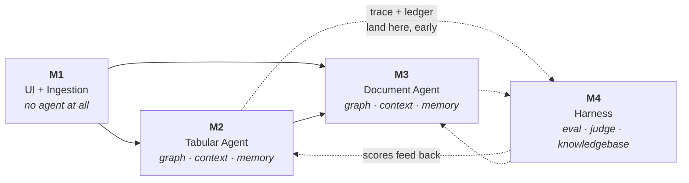

# DataSurf — Module Map

**2026-09-29** · companion to [datasurf-plan.md](datasurf-plan.md) and
[folder-structure.md](folder-structure.md)

This document exists so you never have to hold the whole project in your head. Four modules. Each one
is a thing you can finish, demo, and stop thinking about.

---

## How to read this

The main plan describes **phases (P0–P5)** — a delivery order. This document describes **modules
(M1–M4)** — what the thing is made of. They are two views of the same work, mapped in §7.

Work module by module. Inside a module, work milestone by milestone. Do not start a module until the
one it depends on has a passing done-check.



**The dotted edges matter.** M4 is listed last but is not built last — see §6.

---

## M1 — UI and Ingestion

**No agent. No model call. No API key required to run it.**

This is the module that derisks the hardest unglamorous problem in the project (messy Excel) before
any AI complexity exists to confuse the debugging.

### What it does

Upload a file → detect its type → parse it → normalize it → show the user what was understood.

### Milestones

| | Milestone | Deliverable |
|---|---|---|
| **M1.1** | Streamlit shell | Upload widget accepting `.csv .xlsx .xlsm .pdf`, a file list, a session banner saying data is session-only. Nothing else. |
| **M1.2** | Tabular read | csv + xlsx (all sheets) into pandas. Sheet picker when a workbook has several. |
| **M1.3** | Header detection | Find the real header row in a workbook where it isn't row 0. Show what was detected and let the user override. **The hardest part of this module.** |
| **M1.4** | Normalization | snake_case columns, dtype coercion, date parsing, currency/unit stripping, dedupe, missingness map — with a changelog of every transformation. |
| **M1.5** | Schema Card | The profiler: per-column type, range, nulls, cardinality, samples, plus the notes block. Render it in the UI. |
| **M1.6** | DuckDB registry | `con.register(name, df)` per table, session-scoped. A tables panel showing what is queryable. |
| **M1.7** | PDF intake | Accept and store PDFs, extract raw text, show page count and a preview. **Parsing only — no chunking, no embedding, no RAG.** That is M3. |

### Done when

Upload a deliberately awful workbook — headers on row 4, merged cells, a stray totals row, dates as
serial integers — and the app shows a correct Schema Card without hand-holding, or asks one good
question about the header row. **With no model call anywhere in the path.**

### Explicitly not in M1

Chat box · any LLM call · chunking or embeddings · presets · charts beyond a trivial preview · joins
across files.

---

## M2 — Tabular Agent

The centrepiece. Everything agentic about structured data.

### What it does

A question in natural language becomes a verified answer with the query that produced it.

### Milestones

| | Milestone | Deliverable |
|---|---|---|
| **M2.1** | One-shot agent | `agent/llm.py` adapter → OpenRouter. Question → SQL → DuckDB → answer, with the SQL shown. No graph yet. **Plus the token ledger from day one** (see §6). |
| **M2.2** | The graph | LangGraph: `pre_route` → **lane** → plan → act → verify → repair → synthesize. Lane is the first conditional edge (§9 Q-B) and **replaces the old `route` node outright** — one model call saved per question. `verify` is conditional on tier. Handle pattern and artifact store. |
| **M2.3** | Tier routing | Deterministic pre-router (0 model calls) · Tier 0 answers from the Schema Card · Tier 1 `column_stat` lookup · Tier 2 generates SQL. See main plan §6. |
| **M2.4** | Deterministic analysis | `analysis/` — auto-EDA, data health, correlation and contingency matrices, outliers, trends, segment comparison. Pure pandas/numpy/scipy, no LLM. Each exposes one preset entry point. |
| **M2.5** | Domain packs | Detect a table's domain from its Schema Card, load one pack: financial · medical · legal · scientific · generic. See below. |
| **M2.6** | Specialist split | Supervisor + TabularAnalyst + ReportWriter + Critic, each with a subsetted tool list. |
| **M2.7** | MCP boundary | Extract tools into a FastMCP server; the app becomes a client. Verify by registering the same server in Claude Code. |

### Domain packs, not domain agents

You asked for a financial analyst, a medical analyst, a legal analyst and a scientific analyst. They
would all write the same SQL. What actually differs between them is four things — so ship those four
things, not four agents:

```
domains/financial.py
    vocabulary   : MRR, churn, AR ageing, gross vs net, fiscal calendar
    metrics      : the derived columns worth computing, and their formulas
    presets      : cohort retention, ageing buckets, margin waterfall
    caveats      : "revenue" is ambiguous until you know recognised vs booked
    detect_hints : column names, value shapes, date cadence
```

One `TabularAnalyst`, one pack loaded at a time, selected by `domains/detect.py` from the Schema Card.

**Why this is the better shape:**

- **Tokens.** One pack enters context, not four agent definitions.
- **Correctness.** No routing decision that can pick the wrong specialist and stay silently wrong.
- **Extensibility.** A fifth domain is one file, not one agent plus its wiring.
- **Testability.** `detect()` is a pure function over a Schema Card — directly unit-testable, unlike
  "did the supervisor route to the right agent".

Reversible: if a domain genuinely needs its own tools and its own graph path, promote that one pack to
an agent. Don't promote all four on principle.

> **Scope note for medical and legal.** These packs describe *data*, not subject matter — what the
> columns mean, what distributions are normal, what is missing, what to flag for a human. They do not
> produce clinical or legal conclusions. Keep that boundary in the pack's system prompt and state it
> in the UI. It is a prompt-design constraint, not a disclaimer to bolt on later.

### Done when

A messy workbook answers a free-form question correctly with the SQL visible; a deliberately broken
column name self-repairs within two attempts; "how many rows" spends zero model calls; and the trace
shows all three.

### Cross-cutting work that lands here

**Graph engineering** — nodes, conditional edges, the repair cycle, checkpointing, interrupts.
**Context engineering** — Schema Card as cached prefix, handle pattern, tool-schema pruning, capped
tool results. **Memory management** — rolling summary after N turns, pinned facts, the session-scoped
data dictionary.

---

## M3 — Document Agent

Everything agentic about unstructured data. Reuses M2's graph; swaps the tools and the lane.

### What it does

A PDF becomes a searchable, categorized, citable corpus — and then answers questions with page
references.

### Milestones

| | Milestone | Deliverable |
|---|---|---|
| **M3.1** | Extract and store | Page-aware text extraction, table extraction where present, per-page storage keyed for citation. Builds on M1.7. |
| **M3.2** | Chunk and embed | Layout-aware chunking, local MiniLM embeddings, numpy cosine over one matrix. (Uncomment `sentence-transformers` here — it pulls torch, ~2GB.) |
| **M3.3** | Doc Card | The document's equivalent of the Schema Card: page count, detected sections, table inventory, document type. ~180 tokens. |
| **M3.4** | Categorization | Classify the document — report, contract, paper, statement, form — which selects the same domain pack M2 uses. |
| **M3.5** | Initial verdicts | On ingest, without being asked: what this document is, what it covers, what looks notable, what is missing. The document analogue of auto-EDA. |
| **M3.6** | Agentic RAG | `search_docs` · `get_page` · `quote` bound to `act` when `state.lane == document`. Retrieval is a tool call the agent decides to make, not a fixed pre-step. No new graph — see §9 Q-B. |
| **M3.7** | Hybrid questions | Questions spanning both lanes: "does the revenue in this sheet match what the report claims on page 7" — answered with both the query and the quote. |

### Done when

A hybrid question returns a number from DuckDB, a quote from the PDF with a page number that actually
exists, and a clear statement of whether they agree.

### Cross-cutting work that lands here

**Graph engineering** — the document lane's conditional edges and its own verify rules (does the cited
page exist, does the quote appear on it). **Context engineering** — Doc Cards, retrieved-chunk budget,
citation compression. **Memory management** — which retrieved chunks survive into the next turn.

---

## M4 — Harness Engineering

Eval, judge, knowledgebase, loops, replay. What separates this from a demo.

### What it does

Makes every claim in the project measurable, and every failure reproducible.

### Milestones

| | Milestone | Deliverable | Lands during |
|---|---|---|---|
| **M4.1** | Trace + ledger | JSONL per run, every node in/out, tokens in/out/cached, cost per call. Sidebar panel. | **M2.1 — first** |
| **M4.2** | Budget guard | Per-question ceilings on tokens, steps, wall-clock. Over budget degrades to a partial answer that says so. | M2.2 |
| **M4.3** | Golden set | ~30 questions across 3 fixtures with expected values. Numeric answers exact, citations checked for existence. | M2 end |
| **M4.4** | Replay | `replay.py <trace_id>` re-runs a recorded session offline against recorded tool outputs. Turns any real failure into a regression test. | M3 |
| **M4.5** | Judge | A model scoring narrative quality where exact match doesn't apply. Sees question + answer + provenance only. | M3 end |
| **M4.6** | Knowledgebase | What the system has learned that outlives a single question: domain pack facts, column semantics, question→SQL pairs for the semantic cache, known-bad patterns. | M4 |
| **M4.7** | Optimization sweep | Prompt caching, semantic cache, rolling summary, tool-schema pruning — each measured on and off. | M4 |
| **M4.8** | Model comparison | The golden set across `gpt-6-luna`, `nemotron-3-super:free`, `deepseek-v4-flash`. | M4 |

### Done when

The README carries two real tables over 30 golden questions: naive vs optimized on one model, and one
harness across three models. Accuracy held, tokens and cost cut — **and the techniques that earned
nothing reported too.**

---

## 6. The sequencing trap

**M4 is numbered last. It is not built last.**

M4.1 — the trace and token ledger — must land inside **M2.1**, the very first agent milestone. Not
because it is urgent, but because it is a *baseline*. The entire token-optimization story is
"naive cost X, optimized cost Y." If the ledger arrives after the optimizations, there is no X. You
would be reconstructing a baseline from memory, which is the same as not having one.

Everything else in M4 can wait. The ledger cannot.

**Recommended real build order:**

```
M1.1 → M1.7          ship the whole ingestion module, no LLM
M2.1 + M4.1          first agent call AND the ledger, same sitting
M2.2 → M2.4          graph, tiers, deterministic analysis
M4.2                 budget guard, before a repair loop can cost real money
M2.5 → M2.7          domain packs, specialists, MCP
M4.3                 golden set — now there is something to score
M3.1 → M3.7          document lane, reusing the graph
M4.4 → M4.8          replay, judge, knowledgebase, sweep, comparison
```

---

## 7. Modules mapped to phases

The main plan's P0–P5 and these modules are the same work cut two ways. If they ever disagree, this
document wins for *what to build*, and the main plan wins for *why*.

| Module | Milestones | Old phase(s) |
|---|---|---|
| M1 | M1.1 – M1.7 | P0 ingestion half, P2 Excel work, P3 PDF intake |
| M2 | M2.1 – M2.7 | P0 agent half, P1, P2 presets, P4 |
| M3 | M3.1 – M3.7 | P3 |
| M4 | M4.1 – M4.8 | P1 trace, P5 entirely |

---

## 8. What each module hands the next

The interfaces to keep clean, because they are what let you stop thinking about a finished module.

| From → To | The contract |
|---|---|
| M1 → M2 | A registered DuckDB table plus a Schema Card object. M2 never reads a file. |
| M1 → M3 | Stored page-keyed raw text. M3 never opens a PDF. |
| M2 → M3 | The graph, the state schema, `llm.py`, the context builder. M3 adds a `state.lane` value plus its tool set and verify rules. **It does not fork the graph.** |
| M2/M3 → M4 | A trace event per node with token counts. M4 never instruments nodes itself. |
| M4 → M2/M3 | Scores and a knowledgebase read. It informs prompts; it does not rewrite them at runtime. |

---

## 9. Settled module-level decisions

**Q-A — Which domain pack first? → financial.** Richest public fixture data, clearest derived metrics,
least fraught scope. `generic.py` is the fallback and always exists.

**Q-B — One graph, lane split at the first conditional edge.** A single graph whose first conditional
edge selects the lane from the input type: `tabular` · `document` · `hybrid`. The lane is carried in
`state.lane` and parameterizes the shared nodes rather than duplicating them.

| `state.lane` | tools bound to `act` | rules applied by `verify` |
|---|---|---|
| `tabular` | `run_sql` · `column_stat` · `describe` · `plot` | row count re-runs; figures reconcile against a second aggregate |
| `document` | `search_docs` · `get_page` · `quote` | cited page exists; the quote actually appears on it |
| `hybrid` | both sets | both of the above, plus: do the two sources agree? |

**This edge is usually free.** The file type is known at upload, so when the session holds only tables
or only documents the lane is decided by inventory lookup — zero model calls. A decision is needed
only when both are loaded. The original design spent a model call classifying something
`ingest/router.py` already knew.

One graph means one repair loop, one budget guard, one state schema, one thing to keep in sync. Hybrid
is a flag on shared nodes, not a third path.

**Q-C — Session-scoped memory only for the initial phase.** In-session: data dictionary, semantic
cache, rolling summary, preset findings feeding tier 1 — all die with the session. Authored and shipped with
the repo: domain pack facts, known-bad patterns, detect hints, all as code in `domains/`. Nothing
user-derived outlives the tab. The ephemeral decision survives intact, and `harness/knowledge.py`
becomes a session-scoped read/write plus a repo-backed read — not a database.
